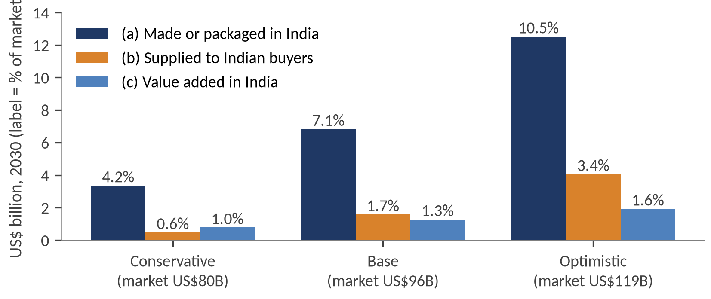

# India Semiconductor Industry: Market Opportunity & Strategic Investment Analysis (2026–2030)

**The answer in one line:** Partly. By 2030 India can be a credible chip-packaging location with about 1–2% of world capacity, cost-competitive only because of subsidy; a mature-node fab is possible but loses money until the early 2030s, and leading-edge fabrication is not realistic.

**Read it:** [Report (PDF)](report/India_Semiconductor_Report.pdf) · [Report (Word)](report/India_Semiconductor_Report.docx) · [Executive deck (PDF)](deck/India_Semiconductor_Executive_Presentation.pdf) · [Excel model](model/India_Semiconductor_Model.xlsx)

## The question and the hypothesis

**Question.** Can India become a globally competitive chip manufacturing and supply-chain hub by 2030, and which parts of the value chain are most attractive?

**Starting hypothesis.** By 2030, India has a realistic opportunity to compete in assembly, testing and packaging, and in selected mature-node and compound-semiconductor manufacturing. Leading-edge fabrication will remain difficult because of technology, capital, ecosystem and supply-chain constraints.

The report tests this against three criteria: domestic manufacturing contribution, position in the global supply chain, and manufacturing economics. Section 11 gives the verdict.

## Five key findings

| # | Measure | Value | Report section |
|---|---|---|---|
| 1 | India chip consumption, FY25 → 2030 (base case) | US$52B → US$96B | 3 |
| 2 | India 2030: made or packaged / supplied to Indian buyers / value added | 7.1% / 1.7% / 1.3% of demand | 9.1 |
| 3 | India's share of global assembly and test, 2030 (base case, by value) | ~1.6% (Malaysia ~7% today) | 5.4 |
| 4 | Reference packaging plant, 10-year IRR: no support vs ~65% support | −1.1% vs 15.9% | 9.2 |
| 5 | Reference fab, break-even loading in 2033: no support vs ~65% support | 128% vs 60% (20-year IRR at best 7.0%) | 9.3 |



*Exhibit 13: what is made or packaged in India in 2030, what reaches Indian buyers, and what value stays in India. Labels show % of the market.*

## Methods

- **Market sizing.** Compares published market estimates, then projects IESA's US$52B FY25 base at 9%, 13% and 18% a year. Reconciles consumption with TradeStat imports (HS 8541/8542), after removing solar products.
- **SQL tracker.** Loads the 12 approved units (₹1,64,293 crore) into a SQLite database and answers concentration questions with plain SQL.
- **Benchmarking.** Compares India with other chip hubs, including Malaysia and Vietnam, on subsidy, cost, home market, suppliers and customers. Results are in Report Section 5 and the workbook.
- **Peer foundry dataset.** Six mature-node foundries (UMC, VIS, SMIC, Hua Hong, GlobalFoundries, PSMC), built from filings, to estimate revenue per wafer and break-even utilisation.
- **Reference OSAT and fab models.** A packaging plant built from Amkor's cost structure and CG Semi's size and revenue target, and a Dholera-sized fab costed from UMC's accounts. Each runs across support cases.
- **Correlated Monte Carlo.** 10,000 runs with triangular inputs for Sanand and Dholera, with utilisation and price correlated at ρ = 0 and ρ = 0.7 (and 1.0 as a bound).

## Notebooks, report sections and outputs

Run the notebooks in this order. "Phase" in a notebook's text means the project's working phase, not a report section.

| Notebook | Report section | What it does | Data outputs (`data/`) | Chart outputs (`charts/`) |
|---|---|---|---|---|
| [`phase2_trade`](notebooks/phase2_trade.ipynb) | 3 | Import series, solar adjustment, gap table | `tradestat_with_ex_solar.csv`, `phase2_gap_table.csv` | `chart_phase2_trade.png` |
| [`phase4_tracker_sql`](notebooks/phase4_tracker_sql.ipynb) | 6 | 12-unit tracker in SQLite, concentration queries | `tracker.db` | None |
| [`phase5_micron`](notebooks/phase5_micron.ipynb) | 7 | Micron cycle, earnings-call mentions, Sanand scenarios and Monte Carlo | `sanand_scenarios_2026_2030.csv`, `sanand_montecarlo_summary.csv`, `sanand_tornado.csv` | `chart1_micron_revenue_gm.png`, `chart2_call_mentions.png`, `chart3_montecarlo_2030.png`, `chart4_tornado.png` |
| [`phase6_tata`](notebooks/phase6_tata.ipynb) | 8 | Foundry peers, break-even estimates, Dholera ramp Monte Carlo | `foundry_peers_with_ratios.csv`, `dholera_scenarios_2028_2032.csv`, `dholera_montecarlo_summary.csv`, `dholera_tornado_2030.csv`, `dholera_demand_fit.csv` | `chart1_peers_util_gm.png`, `chart2_dholera_ramp_mc.png`, `chart3_tornado_2030.png`, `chart4_demand_fit.png` |
| [`phase7_models`](notebooks/phase7_models.ipynb) | 9 | Reference OSAT and fab models, correlated Monte Carlo, India 2030 local supply | `osat_reference_cases.csv`, `osat_tornado.csv`, `fab_reference_cases.csv`, `fab_reference_base_65pct.csv`, `fab_tornado.csv`, `fab_capex_split_sensitivity.csv`, `montecarlo_correlated.csv`, `india_2030_local_supply.csv` | `chart_osat_tornado.png`, `chart_fab_breakeven.png`, `chart_fab_tornado.png`, `chart_india_2030_local_supply.png` |

**Inputs (hand-built, not generated):** `tradestat_hs8541_8542.csv`, `tracker_corrected.csv`, `micron_quarterly.csv`, `call_mentions.csv`, `sanand_inputs.csv`, `foundry_peers.csv`, `psmc_quarterly.csv`, `dholera_inputs.csv`, `osat_inputs.csv`, `fab_inputs.csv`, `jetro_costs.csv`. Each has a source column. `corrections_log.csv` records changes made to earlier figures and is not read by any code.

### Report exhibits and their charts

[`scripts/make_charts.py`](scripts/make_charts.py) redraws the report's charts at print size from the CSVs. The notebooks also save working versions, and some working charts do not appear in the report.

| Report exhibit | Print chart | Working chart from notebook |
|---|---|---|
| Exhibit 2: chip imports vs consumption | [`ex02_trade.png`](charts/ex02_trade.png) | [`chart_phase2_trade.png`](charts/chart_phase2_trade.png) |
| Exhibit 8: Micron's cycle | [`ex08_micron_cycle.png`](charts/ex08_micron_cycle.png) | [`chart1_micron_revenue_gm.png`](charts/chart1_micron_revenue_gm.png) |
| Exhibit 10: Sanand Monte Carlo, ρ = 0 and 0.7 | [`ex10_sanand_mc.png`](charts/ex10_sanand_mc.png) | None (see note) |
| Exhibit 11: peer utilisation vs gross margin | [`ex11_peers.png`](charts/ex11_peers.png) | [`chart1_peers_util_gm.png`](charts/chart1_peers_util_gm.png) |
| Exhibit 12: Dholera ramp | [`ex12_dholera_ramp.png`](charts/ex12_dholera_ramp.png) | [`chart2_dholera_ramp_mc.png`](charts/chart2_dholera_ramp_mc.png) |
| Exhibit 13: India 2030 local supply | [`ex13_local_supply.png`](charts/ex13_local_supply.png) | [`chart_india_2030_local_supply.png`](charts/chart_india_2030_local_supply.png) |
| Exhibit 15: reference fab break-even | [`ex15_fab_breakeven.png`](charts/ex15_fab_breakeven.png) | [`chart_fab_breakeven.png`](charts/chart_fab_breakeven.png) |
| Not in the report | None | [`chart2_call_mentions.png`](charts/chart2_call_mentions.png), [`chart3_montecarlo_2030.png`](charts/chart3_montecarlo_2030.png), [`chart4_tornado.png`](charts/chart4_tornado.png), [`chart3_tornado_2030.png`](charts/chart3_tornado_2030.png), [`chart4_demand_fit.png`](charts/chart4_demand_fit.png), [`chart_osat_tornado.png`](charts/chart_osat_tornado.png), [`chart_fab_tornado.png`](charts/chart_fab_tornado.png) |

*Note: the report's Exhibit 10 source line and Annex G name `chart_sanand_mc_corr.py`. That code is now part of `scripts/make_charts.py`.*

## How to run

Tested on Python 3.13. From the repo root:

```bash
python3 -m venv .venv && source .venv/bin/activate
pip install -r requirements.txt

# Run the notebooks in order (or open them in Jupyter and run top to bottom)
jupyter nbconvert --to notebook --execute --inplace \
  notebooks/phase2_trade.ipynb \
  notebooks/phase4_tracker_sql.ipynb \
  notebooks/phase5_micron.ipynb \
  notebooks/phase6_tata.ipynb \
  notebooks/phase7_models.ipynb

# Redraw the report's charts
python scripts/make_charts.py
```

Random seeds are fixed, so you should get these numbers:

| Check | Expected | Where |
|---|---|---|
| Sanand 2030 Monte Carlo at ρ = 0 (P10 / P50 / P90, US$B) | 3.36 / 5.17 / 7.71 | `data/montecarlo_correlated.csv` |
| Reference fab break-even in 2033, no support vs ~65% support | 128% vs 60% | `data/fab_reference_cases.csv` |
| India 2030 base case: made or packaged / supplied / value added | 7.1% / 1.7% / 1.3% | `data/india_2030_local_supply.csv` |

## Data sources

Official sources come first; the full list is in the report's References, and the number-by-number register is in the workbook's *Sources and assumptions* tab.

Source documents are **not** included here because they are copyrighted by their publishers. This repo holds only my own derived CSVs. Find the originals here:

| Report ref. | Source | Link |
|---|---|---|
| 1 | PIB: Cabinet approves Semicon 2.0 | [PIB release](https://www.pib.gov.in/PressReleasePage.aspx?PRID=2284784) |
| 2–4 | India Semiconductor Mission: scheme guidelines and notifications, DLI scheme | [ISM notices](https://www.ism.gov.in/notifications/notices) |
| 5–9 | PIB: Tata fab support, Assam OSAT, Cabinet approvals, Micron Sanand | [5](https://www.pib.gov.in/PressReleasePage.aspx?PRID=2108602) · [6](https://www.pib.gov.in/PressReleasePage.aspx?PRID=2041162) · [7](https://www.pib.gov.in/PressReleasePage.aspx?PRID=2010135) · [8](https://www.pib.gov.in/PressReleasePage.aspx?PRID=2233998) · [9](https://www.pib.gov.in/PressReleasePage.aspx?PRID=2258116) |
| 10 | PRS: MeitY Demand for Grants analysis 2026-27 | [PDF](https://prsindia.org/files/budget/budget_parliament/2026/DFG_Analysis_2026-27_MeITY.pdf) |
| 11 | Ministry of Commerce: TradeStat | [TradeStat](https://tradestat.commerce.gov.in) |
| 12 | State policies: Gujarat, Assam, Odisha | [Gujarat (announcement)](https://newsonair.gov.in/gujarat-govt-unveils-semiconductor-policy-2022-2027) · [Assam (PDF)](https://eodb.assam.gov.in/assets/docs/odop/2025/Assam_electronics_semiconductor_etc_231211_101812.pdf) · [Odisha (PDF)](https://investodisha.gov.in/download/Odisha-Semi-Conductor-Manufacturing-and-Fabless-Policy-2023.pdf) |
| 13 | US GAO: CHIPS Act projects, GAO-26-107882 | [GAO](https://www.gao.gov/products/gao-26-107882) |
| 14 | MITI Malaysia: National Semiconductor Strategy | [PDF](https://www.miti.gov.my/miti/resources/NSS_141024.pdf) |
| 15 | Micron: 10-K, 8-Ks, Sanand release, sustainability report | [Micron SEC filings](https://investors.micron.com/sec-filings) |
| 16 | Tata Sons annual report; Tata Electronics releases | [Tata investors](https://www.tata.com/investors) · [Tata Electronics](https://www.tataelectronics.com/) |
| 17–21 | PSMC, UMC, Amkor, CG Power, Kaynes, GlobalFoundries, VIS, SMIC, Hua Hong filings | Each company's investor site, for example [UMC](https://www.umc.com/en/), [Amkor](https://ir.amkor.com/), [CG Power](https://www.cgglobal.com/investors), [SMIC](https://www.smics.com/en/). Some figures came via [Bigdata.com](https://bigdata.com) tearsheets. |
| 22 | WSTS: Spring 2026 forecast and Q2 2026 release | [Spring forecast notice (JEITA)](https://www.jeita.or.jp/japanese/stat/wsts/docs/20260602WSTS.pdf) · [Q2 release](https://www.wsts.org/esraCMS/extension/media/f/WST/7745/WSTS-Q2-Release-2026-08-06.pdf) |
| 23–26 | SIA and SIA–BCG reports | [2015 sales](https://semiconductors.org/global-semiconductor-sales-top-335-billion-in-2015) · [Emerging Resilience (2024)](https://www.semiconductors.org/emerging-resilience-in-the-semiconductor-supply-chain/) · [Strengthening the Supply Chain (2021)](https://www.semiconductors.org/strengthening-the-global-semiconductor-supply-chain-in-an-uncertain-era/) · [Government Incentives (2020)](https://www.semiconductors.org/study-finds-federal-incentives-for-domestic-semiconductor-manufacturing-would-strengthen-americas-chip-production-economy-national-security-supply-chains/) |
| 27 | SEMI: equipment billings, 300 mm outlook and spending | [SEMI](https://www.semi.org/) |
| 28 | IESA: India Semiconductor Market Report 2030 | [Invest India summary](https://indbiz.gov.in/indias-semiconductor-market-set-to-reach-103-4-billion-by-2030) |
| 29 | EY and IESA: Semicon India 2.0 | [Press coverage](https://ddindia.co.in/2026/09/indias-semiconductor-market-projected-to-cross-usd-200-billion-by-2035-ey-iesa-report/) |
| 30 | JETRO: Investment Cost Survey, Asia and Oceania (Excel files) | [JETRO cost comparison (Japanese)](https://www.jetro.go.jp/world/business_environment/cost/) |
| 31 | TrendForce: OSAT, DRAM, NAND and foundry reports | [TrendForce press center](https://www.trendforce.com/presscenter/news) |

## Limitations

Reference facilities are illustrative, not company economics.

Other data cautions are in Annex E of the report.

## Licence

Code is under the MIT License. The report text and charts are mine, all rights reserved. See [LICENSE](LICENSE).

## Author

**Harsh Jain**, Indian Institute of Technology Gandhinagar

Contact: [harsh.jain@iitgn.ac.in](mailto:harsh.jain@iitgn.ac.in)
